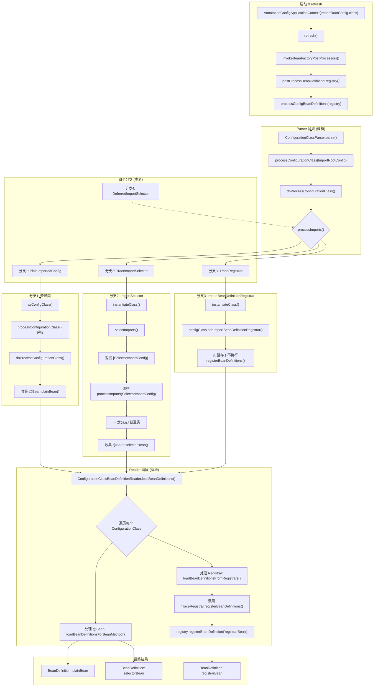

# 实验一：@Import 三/四分支 — 完整调用链

基于 `ImportRootConfig` + `@Import(PlainImportedConfig, TraceImportSelector, TraceRegistrar)`。

方框=方法/入口，菱形=分支判断，圆角=模型/BeanDefinition。



---

## 关键时间线

```text
Parser（只建模，不注册）
│
├── ImportRootConfig 解析开始
│   ├── processImports() 遍历三个导入候选
│   │
│   ├── [1] PlainImportedConfig → 普通类
│   │   └── 递归 processConfigurationClass()
│   │       └── doProcessConfigurationClass()
│   │           └── 发现 @Bean plainBean
│   │               └── configClass.addBeanMethod(plainBean) ← 仅建模
│   │
│   ├── [2] TraceImportSelector → ImportSelector
│   │   └── 立即执行 selectImports()
│   │       └── 返回 "SelectorImportConfig"
│   │           └── 递归 processConfigurationClass()
│   │               └── 发现 @Bean selectorBean
│   │                   └── configClass.addBeanMethod(selectorBean) ← 仅建模
│   │
│   └── [3] TraceRegistrar → Registrar
│       └── configClass.addImportBeanDefinitionRegistrar(traceRegistrar) ← 暂存！
│
├── DeferredImportSelector 处理 (本实验无)
│
└── validate()

Reader（统一落地到注册表）
│
├── loadBeanDefinitions()
│   ├── 遍历 ImportRootConfig 模型 → 注册其 BeanDefinition
│   ├── 遍历 PlainImportedConfig 模型 → 注册 plainBean BeanDefinition
│   ├── 遍历 SelectorImportConfig 模型 → 注册 selectorBean BeanDefinition
│   │
│   └── loadBeanDefinitionsFromRegistrars()
│       └── TraceRegistrar.registerBeanDefinitions() → 注册 registrarBean ← 此时才执行！
```

## 分支对比总结

| | 普通类 | ImportSelector | Registrar | DeferredImportSelector |
|---|---|---|---|---|
| Parser 阶段做什么 | 递归解析建模 | 执行 selectImports() 后递归解析返回的类 | **只暂存，不执行** | 暂存到 Handler |
| Reader 阶段做什么 | 注册 @Bean | 注册 @Bean | **执行 registerBeanDefinitions()** | 排序分组后走 Selector 流程 |
| 会立即改注册表吗 | 不会 | 不会 | 不会，Reader 才改 | 不会 |
| 本实验涉及吗 | ✅ | ✅ | ✅ | ❌ (实验二) |
